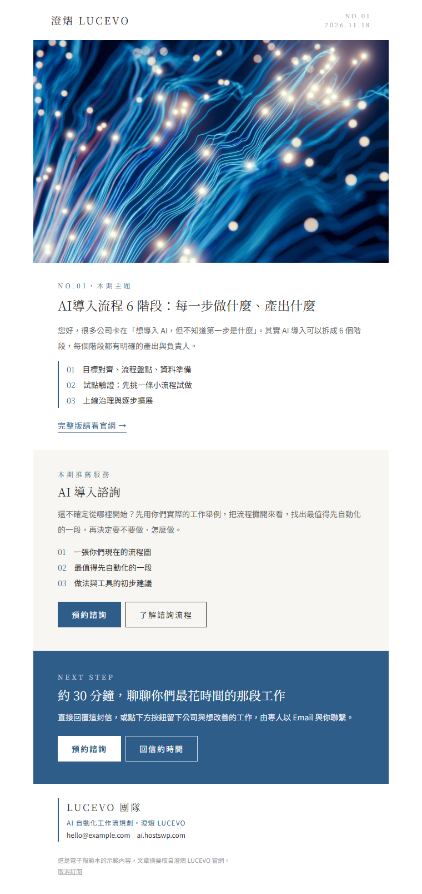
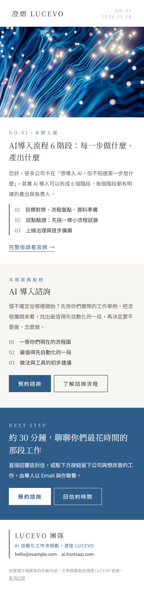

# 繁體中文電子報範本（HTML EDM）：B2B 企業電子報，Gmail／Outlook 都不跑版

**tw-newsletter-template** 是一套開源的繁體中文電子報 HTML 範本，專為 B2B 企業電子報設計：全部用表格排版加行內樣式，Gmail、Outlook、Apple Mail 都能正常顯示，手機上自動上下排。內容寫在一個 JSON 檔，執行一行指令就產出整封信，可以直接貼進 Gmail、Mailchimp、Brevo 等寄信工具的 HTML 編輯器。

範本的結構照「**每期電子報只做 3 件事**」設計：

1. **本期主題**：一篇文章的摘要＋3 個重點，再用「完整版請看官網」把讀者帶回網站。
2. **主推一項服務**：說清楚這項服務適合誰、會拿到什麼。
3. **行動區**：預約諮詢或回信，加上精簡簽名。



## 目錄

- [特色](#特色)
- [怎麼使用](#怎麼使用)
- [內容欄位](#內容欄位)
- [7 種產業配色](#7-種產業配色)
- [常見問題](#常見問題)
- [延伸閱讀](#延伸閱讀)

## 特色

- **繁體中文排版**：明體標題、黑體內文、行距 2.0，中文長段落讀起來不擠。
- **電子報相容寫法**：table 排版、行內樣式、寬度 640px，不依賴外部 CSS 或 JavaScript。
- **手機版**：寬度 600px 以下自動加大留白、標題縮小，不會出現水平捲動。
- **收件匣預覽文字**（preheader）：可以自訂收件匣裡標題後面那一行。
- **一個點綴色**：整封信只換一個顏色，內建 7 種產業配色，也可以填自己的品牌色。
- **零套件**：只需要 Node.js 18 以上。

## 怎麼使用

```bash
git clone https://github.com/ymlin520/tw-newsletter-template.git
cd tw-newsletter-template
node bin/build.js examples/ai-adoption-process.json out.html
```

打開 `out.html` 就是整封信。複製全部原始碼，貼到寄信工具的「HTML 編輯」或「自訂程式碼」區塊即可。

在自己的程式裡使用：

```js
import { renderNewsletter } from "./src/newsletter.js";
const html = renderNewsletter({ accent: "pro", issue: { title: "…", summary: "…" } });
```



## 內容欄位

| 欄位 | 說明 |
|---|---|
| `accent` | 點綴色：`factory`、`logistics`、`commerce`、`pro`、`care`、`life`、`space`，或直接填色碼 |
| `preheader` | 收件匣預覽文字 |
| `greeting` | 開頭稱呼，例如「王經理您好」 |
| `brand` | `name`、`url`、`logo`（沒有 logo 會顯示品牌名稱文字） |
| `issue` | 本期主題：`number`、`date`、`title`、`summary`、`points`（3 個重點）、`url`、`image` |
| `service` | 主推服務：`name`、`pitch`、`items`、`buttons` |
| `cta` | 行動區：`title`、`text`、`items`、`buttons`（第一顆是主要按鈕） |
| `signature` | 簽名：`name`、`title`、`email`、`phone`、`website` |
| `footer`、`unsubscribe` | 頁尾小字與取消訂閱連結 |

完整範例見 [`examples/`](examples/)，產出的 HTML 在 [`docs/`](docs/)。

## 7 種產業配色

| 代號 | 適合產業 | 色碼 |
|---|---|---|
| `factory` | 工業製造、批發 | `#2F5D8A` |
| `logistics` | 物流、貿易 | `#2C6FA8` |
| `commerce` | 電商、行銷 | `#7A5FA8` |
| `pro` | 會計、法律、顧問 | `#A48450` |
| `care` | 診所、醫美 | `#4E9484` |
| `life` | 餐飲、旅遊、教育 | `#C9824A` |
| `space` | 建設、室內設計 | `#9A7B5A` |

## 常見問題

**Outlook 會跑版嗎？**
範本只用表格、行內樣式和網頁安全字型的備援，色塊同時寫 `bgcolor` 屬性，Outlook 桌面版也能維持主要版面；圓角、陰影這類 Outlook 不支援的效果一律不用。寄出前仍建議先寄給自己的 Outlook 測一次。

**圖片要放哪裡？**
電子報裡的圖片必須是公開網址（例如網站媒體庫），不能用本機檔案。`issue.image` 可以不填，版面會自動改成純文字開頭。

**為什麼每期只放一篇文章？**
B2B 讀者時間很少，一封信只講一件事、只推一項服務，讀者比較知道下一步要做什麼；完整內容放在官網，也能把電子報讀者帶回網站。

**可以用在 Mailchimp、Brevo 嗎？**
可以，貼進 HTML 編輯器即可；取消訂閱連結請換成該平台提供的變數。

## 延伸閱讀

電子報要能帶來詢問，關鍵在後面的流程：誰開信、誰點了哪個連結、多久後跟進。這類工作很適合用自動化處理：

- [AI導入懶人包：費用、補助、流程重點一次看懂](https://ai.hostswp.com/ai-adoption/)
- [AI導入案例：客服、行銷、營運 5 個部門的實際做法](https://ai.hostswp.com/ai-adoption/cases/)
- [AI自動化工作流案例：12 個產業示範](https://ai.hostswp.com/ai-automation-workflow-cases/)
- 同系列工具：[AI 自動化潛力檢測](https://github.com/ymlin520/ai-automation-checker)

想把電子報、名單整理、跟進信串成自動流程，可以 [預約 AI 導入諮詢](https://ai.hostswp.com/ai-consulting-2/)。

---

## English

**tw-newsletter-template** is a Traditional Chinese (zh-TW) B2B email newsletter HTML template. Table-based layout with inline styles, works in Gmail, Outlook and Apple Mail, responsive on mobile. Write content in JSON, run `node bin/build.js content.json out.html`. Zero dependencies.

## 授權

MIT License。由 [澄熠 LUCEVO｜AI 自動化工作流規劃](https://ai.hostswp.com/) 製作與維護。
